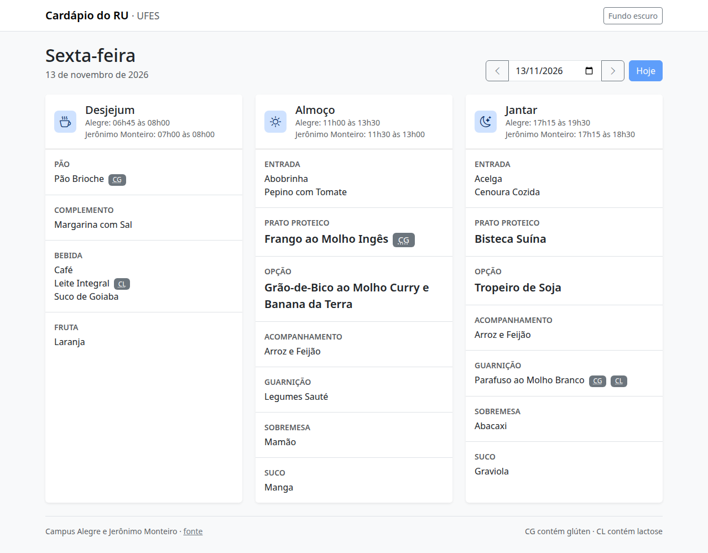
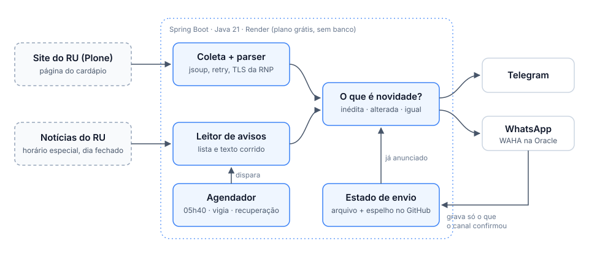

# RU Menu Bot — UFES Alegre

[](https://github.com/Tetzdesen/cardapio-ru/actions/workflows/ci.yml)
[](LICENSE)

*[Leia em português](README.md) — the full documentation is in Portuguese.*

A bot that reads the daily menu of the university restaurant (RU) at UFES, campus Alegre,
Brazil, and posts every meal to a Telegram group and, optionally, a WhatsApp group. Each
post carries the restaurant's opening hours, flags menu changes after the first post, and
warns ahead of the days the restaurant will be closed. It also serves a
[web page with the menu](https://cardapio-ru-x6zv.onrender.com/).

Java 21 · Spring Boot 3.5 · jsoup · runs on Render's free tier, **no database, no external
scheduler**.

<p align="center">
  
</p>

## How it works

<p align="center">
  
</p>

1. **Collect.** Scrapes the menu page for the date and the restaurant's news posts about
   opening hours (shortened hours, closed meals, closed days).
2. **Decide.** Compares each meal against what was already announced: new meals go out,
   unchanged ones are skipped, changed ones are re-sent with a change notice.
3. **Send.** Posts to each configured channel and records only what that channel confirmed.

An in-app scheduler posts the whole day at 05:40, re-checks the site every 20 minutes for
changes, and retries failed posts every 10 minutes until the meal's deadline.

## Technical highlights

- **Scraping a site that changes without notice.** The source is a university Plone site
  with no API. The parser doesn't rely on CSS classes; it finds headings by regex, tolerates
  real-world variations, and when it meets an unknown section label it logs a warning and
  still publishes the section instead of dropping content.
- **Reading free-text notices.** Special hours and closures are published as news, either
  as a per-unit, per-day list or as running prose. Both are parsed; when a notice can't be
  understood, the regular schedule is used and the menu still goes out.
- **Idempotent delivery.** Each meal has a signature, and state stores only what each
  channel confirmed, so re-running a dispatch is always safe.
- **Zero-cost infrastructure.** No database: the state is a file mirrored to a branch of
  this repository through the GitHub API, surviving Render's ephemeral disk.
- **Resilience.** Exponential-backoff retries within a time budget for transient errors
  only, a recovery job for failed posts, and failure alerts to a separate chat.
- **TLS without shortcuts.** The university server omits its intermediate certificate;
  instead of disabling verification, the app bundles the intermediate to complete the
  chain, and a test ensures verification can never be turned off.
- **Tests against reality.** 230 tests, none touching the network, run against real pages
  frozen as fixtures, plus a byte-for-byte reference proving the port from the original
  Python bot to Java changed no message.

## Run locally

Requires Java 21 and Maven.

```bash
mvn verify                                                       # build and test
java -jar target/cardapio-ru-*.jar --print                       # print today's menu, send nothing
java -jar target/cardapio-ru-*.jar --spring.profiles.active=web  # start the API on :8080
```

See the [deployment guide (Portuguese)](docs/deploy.md#variáveis-de-ambiente) for the environment
variables (Telegram, WhatsApp via WAHA, API token, state mirroring).

## License

[MIT](LICENSE).
