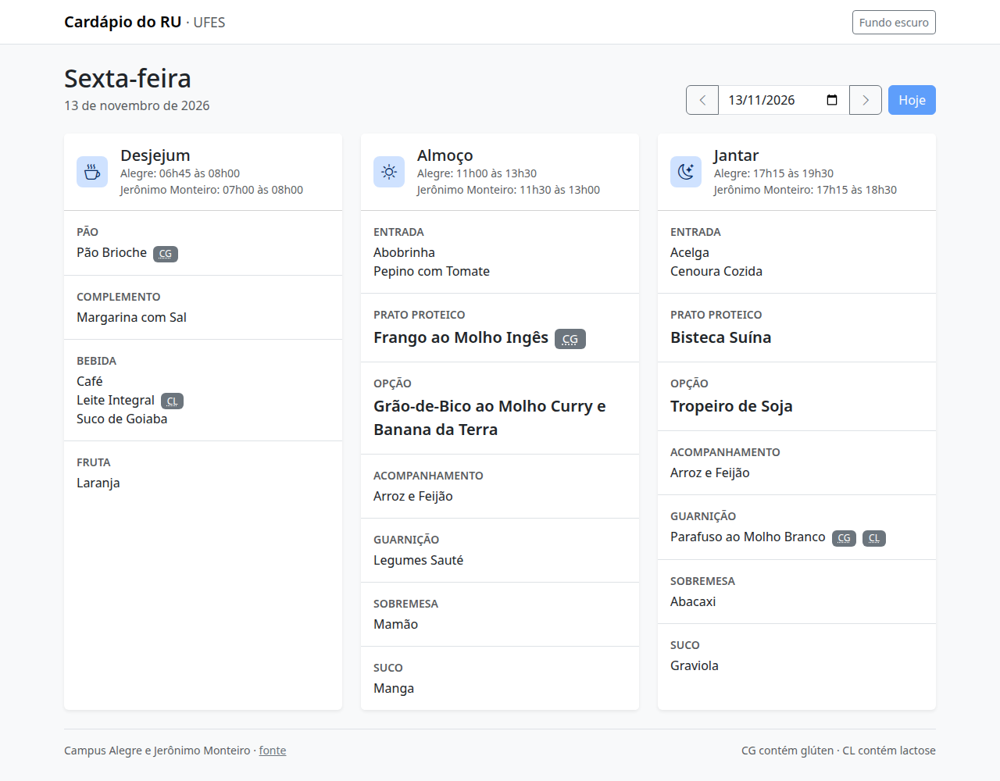
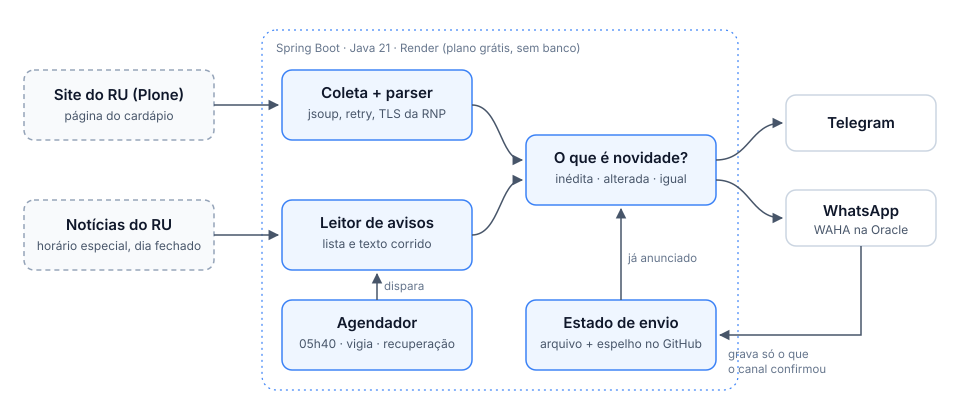

# Cardápio do RU — UFES Alegre

[](https://github.com/Tetzdesen/cardapio-ru/actions/workflows/ci.yml)


[](LICENSE)

*[English summary](README.en.md)*

Bot que coleta o cardápio do Restaurante Universitário da UFES em Alegre e o anuncia todos
os dias em grupos do Telegram e do WhatsApp, com o horário de funcionamento, aviso quando o
cardápio muda e aviso antecipado dos dias sem RU. A mesma aplicação serve uma
[página web do cardápio](https://cardapio-ru-x6zv.onrender.com/).

<p align="center">
  
</p>

## Funcionalidades

- **Anúncio diário às 05h40**, com o cardápio do dia inteiro numa única mensagem.
- **Detecção de mudanças:** a cada 20 minutos o site é reconsultado; refeições alteradas
  são reenviadas com aviso.
- **Horários e fechamentos:** interpreta as notícias do RU (horário reduzido, refeição
  suspensa, dia fechado) e avisa o grupo com antecedência.
- **Recuperação automática:** um envio que falhou é repetido até o prazo da refeição, com
  alerta num chat privado.
- **API REST e página web** para consultar o cardápio de qualquer data.

## Arquitetura

<p align="center">
  
</p>

1. **Coleta** — baixa o cardápio e as notícias do site e extrai refeições e exceções de horário.
2. **Decisão** — compara cada refeição com o estado de envio: inédita, alterada ou já anunciada.
3. **Entrega** — envia a cada canal e registra apenas o que o canal confirmou.

## Destaques técnicos

- **Scraping resiliente.** O site (Plone) não tem API e muda sem aviso. O parser não
  depende de classes CSS, tolera variações reais da marcação e, diante de um rótulo
  desconhecido, publica o conteúdo e registra um aviso em vez de descartá-lo.
- **Entrega idempotente.** Cada refeição tem uma assinatura de conteúdo e o estado é
  registrado por canal; repetir um disparo nunca gera mensagem duplicada.
- **Custo zero, sem banco de dados.** Roda no plano gratuito do Render; o estado é um
  arquivo JSON espelhado num ramo do próprio repositório via API do GitHub.
- **Tolerância a falhas.** Retry com backoff exponencial dentro de um orçamento de tempo,
  canais isolados entre si (padrão Strategy) e alertas de falha.
- **TLS correto.** O servidor da UFES omite o certificado intermediário; a aplicação
  completa a cadeia com o certificado da RNP em vez de desativar a verificação.
- **230 testes automatizados** contra páginas reais congeladas como fixtures, sem acesso à
  rede.

## Tecnologias

Java 21 · Spring Boot 3.5 (Web, Security, Actuator, Scheduling) · jsoup · JUnit 5 ·
Docker · Render · GitHub Actions · WAHA (WhatsApp HTTP API)

## Como rodar

Requer Java 21 e Maven.

```bash
mvn verify                                                       # compila e testa
java -jar target/cardapio-ru-*.jar --print                       # mostra o cardápio de hoje, sem enviar
java -jar target/cardapio-ru-*.jar --spring.profiles.active=web  # sobe a API em :8080
```

Para enviar aos grupos, defina `TELEGRAM_TOKEN` e `TELEGRAM_CHAT_ID` (e, opcionalmente, as
variáveis do WhatsApp). A lista completa está em [Deploy e configuração](docs/deploy.md).

## Exemplo de mensagem

```
🌙 *Jantar* — sexta-feira, 23 de Outubro de 2026
📍 _Alegre e Jerônimo Monteiro_
⚠️ Alegre: 17h15 às 18h30 *(horário reduzido)*

🍗 *Prato Proteico*
• Sassami à Milanesa (CG)

🧃 *Suco*
• Acerola 🍒
```

## Documentação

| documento | conteúdo |
|---|---|
| [Funcionamento](docs/funcionamento.md) | agenda, horários, dias sem RU, canais e estado de envio |
| [Deploy e configuração](docs/deploy.md) | Render, variáveis de ambiente, alertas e limites do plano grátis |
| [API HTTP e linha de comando](docs/api-e-cli.md) | endpoints, parâmetros, códigos de status e de saída |
| [Desenvolvimento](docs/desenvolvimento.md) | execução local, Docker, estrutura do código, testes e manutenção do parser |
| [WhatsApp](whatsapp/README.md) | configuração do WAHA |

## Licença

Distribuído sob a [licença MIT](LICENSE).
