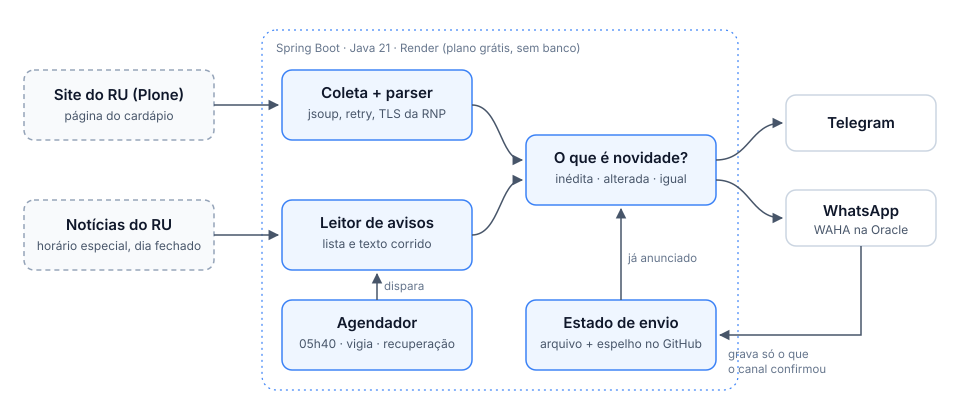

# Funcionamento

[← voltar ao README](../README.md)

## Como funciona



1. **Coleta.** Baixa a página do cardápio da data e extrai as refeições, cada uma com as
   suas seções (entrada, prato proteico, sobremesa...). Baixa também as notícias da
   página inicial que falam de horário ou atendimento e tira delas as exceções: horário
   reduzido, refeição sem atendimento, dia fechado.
2. **Decisão.** Compara cada refeição com o que já foi anunciado (o [estado](#estado)):
   inédita vai, inalterada fica de fora, alterada volta com aviso de mudança.
3. **Envio.** Manda a cada canal configurado e grava só o que o canal confirmou.

No Render, quem dispara é o `Agendador`, dentro da própria API. O mesmo jar também roda
pela [linha de comando](api-e-cli.md#linha-de-comando), para conferir o cardápio ou anunciar à mão.

## O que vai ao grupo

### Agenda

O anúncio sai no fuso `America/Sao_Paulo` (`agenda.*` em `application.yml`):

| horário | dias | o que faz |
|---|---|---|
| **05h40** | seg–sáb | anuncia o cardápio do dia inteiro (sábado só tem almoço) |
| a cada 20 min, 6h–19h59 | seg–sáb | **vigia**: reanuncia o que mudou |
| a cada 10 min, 5h–19h59 | seg–sáb | **recuperação**: tenta de novo o anúncio que falhou |

O dia inteiro chega numa mensagem só, cedo, na hora em que quem vai ao RU está acordando.
As correções que o site faz depois ficam com a vigia. Todos os disparos da agenda pedem o
campus `alegre`.

A **recuperação** tenta de novo, a cada 10 minutos, o anúncio que falhou (site da UFES
fora do ar, canal recusando), pedindo só as refeições ainda no prazo — desjejum 07h30,
almoço 13h00, jantar 19h00 (`agenda.prazo.*`). Depois do prazo o RU já está fechando e
anunciar não serve a ninguém; passado o do jantar, ela desiste e avisa. Repetir é seguro: o estado garante que o canal que já recebeu não recebe de
novo. Só entra o que falhou no processo que está no ar; o anúncio que nem chegou a rodar,
porque o serviço reiniciava na hora exata, fica de fora.

A **vigia** reconfere o site ao longo do dia. Se uma refeição que já foi para o grupo mudar
depois, ela volta com "⚠️ O cardápio mudou desde o último aviso." A vigia não antecipa
nada que ainda não foi anunciado e, em dia sem cardápio, fica quieta.

### Horário de funcionamento

Cada refeição vem com o horário da unidade, logo abaixo do campus: `🕒` no horário
regular, `⚠️ ... (horário reduzido)` quando um aviso o encurta, `🚫 sem atendimento`
quando a unidade não abre.

O horário regular fica no código (`QuadroDeHorarios`), copiado da página de
funcionamento do RU, porque muda uma vez por semestre, se tanto:

| refeição | Alegre | Jerônimo Monteiro |
|---|---|---|
| desjejum | 06h45 às 08h00 | 07h00 às 08h00 |
| almoço | 11h00 às 13h30 | 11h30 às 13h00 |
| jantar | 17h15 às 19h30 | 17h15 às 18h30 |
| almoço de sábado | 11h00 às 12h30 | 11h30 às 12h30 |

O que muda de uma semana para outra vem dos avisos da página inicial, lidos de novo a
cada 30 minutos. Na falha (site fora, aviso ilegível), vale o horário regular: o
horário enfeita o anúncio e não pode segurar o cardápio.

O horário respeita o campus pedido: com `alegre`, o grupo não recebe o de Jerônimo
Monteiro. O horário fica fora da assinatura do estado — aviso de horário novo não é
cardápio novo e não reenvia o dia.

### Dias sem RU

Quando um aviso dá uma unidade como fechada o dia inteiro, o grupo é avisado duas vezes,
cada uma uma vez só por canal:

- **antes**, até 7 dias de antecedência, no primeiro anúncio depois de o aviso sair:
  `🚫 Amanhã não vai ter RU — sábado, 24/10` (ou `Não vai ter RU — segunda-feira, 26/10`);
- **no próprio dia**: `🚫 Hoje não tem RU — sábado, 24/10`.

Refeição sem atendimento não manda o cardápio, mesmo que o site o tenha publicado. No dia
sem RU fica só o aviso do dia; no dia fechado só em parte vai `🚫 Sem jantar hoje` no
lugar do cardápio do jantar. Como essa refeição não é gravada, se o aviso for retirado o
cardápio ainda sai normalmente. Num dia fechado, a falta de página de cardápio também não
conta como falha.

O aviso do RU é entendido em dois formatos:

- **Lista por unidade e por dia**, como o RU publica os horários especiais:

  ```
  📍 RU Alegre
  🗓️ Sábado (24/10/2026)
  🚫 Fechado durante todo o dia
  🗓️ Segunda-feira (26/10/2026)
  🍲 Jantar: Sem atendimento
  ```

- **Texto corrido**, só para o dia inteiro: "nos dias 30 (sexta-feira) e 31 de outubro
  (sábado) não haverá atendimento". A frase precisa fechar o RU e não citar refeição; a
  data pode ser numérica ou por extenso, e data entre parênteses não conta ("originalmente
  assinalado a 28 de outubro" não é dia fechado).

Refeição suspensa em texto corrido ("nesse dia não será servido o jantar") fica de fora,
porque a data costuma estar em outra frase: melhor anunciar o horário regular do que um
horário adivinhado.

### Dia sem cardápio

Na agenda, dia sem cardápio publicado não manda nada (`silencioso`). No disparo manual não
silencioso, vai `Sem cardápio publicado para hoje.` — a menos que o dia seja sem RU.

## Canais

Cada destino é um `Canal` (padrão Strategy): o `ClienteTelegram` e o `ClienteWhatsapp`
implementam a mesma interface, e o `DisparoTransacional` aplica a cada canal configurado a
mesma regra — decide o que é novidade, envia, grava — sem saber qual é qual.

| canal | liga com | marcação |
|---|---|---|
| Telegram | `TELEGRAM_TOKEN`, `TELEGRAM_CHAT_ID` | HTML |
| WhatsApp | `WHATSAPP_URL`, `WHATSAPP_API_KEY`, `WHATSAPP_CHAT_ID` | `*negrito*`, convertida na saída |

- Canal sem configuração fica de fora; sem nenhum, o envio falha.
- Os canais falham sozinhos: o WhatsApp fora do ar não impede o Telegram de receber, e o
  disparo seguinte manda só ao canal que ficou para trás.
- Mensagens longas são partidas em até 4000 caracteres, sem cortar uma refeição ao meio.
- O WhatsApp passa pelo [WAHA](../whatsapp/README.md), um servidor que você hospeda fora do
  Render (uma VM grátis da Oracle Cloud serve).

Um canal novo é uma classe que implementa `Canal` e vira `@Component`; o disparo o encontra
sozinho.

## Estado

O que já foi anunciado fica num JSON, uma linha por `(data, refeição, canal)`, com a
assinatura do conteúdo anunciado:

```json
{
  "2026-10-23|almoco": "3697e402437c133a",
  "2026-10-23|jantar": "459106b701d9f528",
  "2026-10-23|jantar|whatsapp": "459106b701d9f528",
  "2026-10-24|sem-ru": "antes"
}
```

- **Cada canal tem a sua entrada.** A do Telegram, que veio primeiro, fica sem sufixo; as
  dos outros levam o nome do canal no fim.
- **A chave não depende de quais refeições o disparo pediu.** É isso que faz disparos que
  pedem refeições diferentes reconhecerem o que têm em comum.
- **`sem-ru`** guarda até onde o dia sem RU já foi avisado: `antes` ou `hoje`.
- **Só se grava o que o canal confirmou.** Se o envio falhar no meio, o que já chegou ao
  grupo fica registrado — reenviar uma refeição que já chegou é pior do que deixar a
  falha visível.
- Entradas mais velhas que 30 dias são podadas na gravação. Entrada ilegível é descartada
  sem erro, e a refeição volta a contar como inédita. Arquivo ausente é o caso normal da
  primeira execução, não é falha.

É o mesmo formato que o `ru_bot.py`, a versão em Python que veio antes, gravava byte a
byte, e a assinatura é calculada sobre o mesmo texto que ele produzia.

### O espelho no GitHub

Com `ESTADO_GITHUB_TOKEN`, o arquivo em disco vira cópia de trabalho do que está no ramo
`estado`: a primeira leitura depois de subir traz o arquivo de lá, e cada gravação vira
um commit nesse ramo (`estado: cardápio anunciado`).

- Não é o `main` de propósito: commit no `main` é deploy no Render, e um deploy por
  anúncio reiniciaria o serviço.
- Se o GitHub falhar, o disco continua valendo e a próxima gravação que o alcançar leva
  tudo junto — sem sobrescrever o ramo com um disco que não o leu. A falha não passa
  calada: o disparo termina com erro e vai ao chat de alerta, para um token quebrado não
  deixar o espelho parado sem ninguém saber.
- Cada envio grava as refeições e os dias sem RU de uma vez só: um commit por envio.
- No log da partida, a aplicação diz onde o estado está (`estado espelhado em ...`).

Fora do Render, sem o token, o estado vive só no disco; na imagem Docker, monte um volume
em `/app/estado`.

## Cuidados

O RU não tem API pública, então isso é scraping. A consulta é servida de um cache curto em
memória, os avisos são relidos no máximo a cada 30 minutos, e o `User-Agent` é
identificável e aponta para este repositório.

Falha passageira do servidor (timeout, 502) é repetida 3 vezes com espera dobrando; erro
definitivo (404, certificado inválido) não é repetido. O total de tentativas cabe num
orçamento de tempo configurado.

A verificação de TLS fica sempre ligada, e não há opção para desligá-la. O servidor da UFES
não envia o certificado intermediário da RNP/ICPEdu, então o `rnp-icpedu.pem` empacotado
com a aplicação completa a cadeia. Se ele faltar, a aplicação avisa **na partida**, não na
primeira consulta que falhar.

A comparação do `API_TOKEN` é em tempo constante, e uma credencial recusada vai ao log
sem o valor apresentado.
